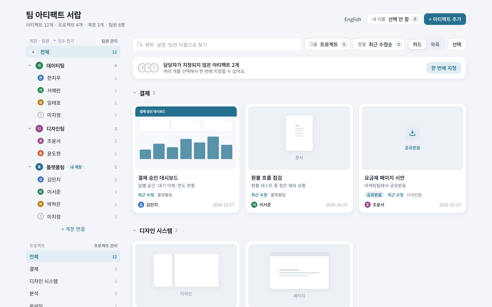
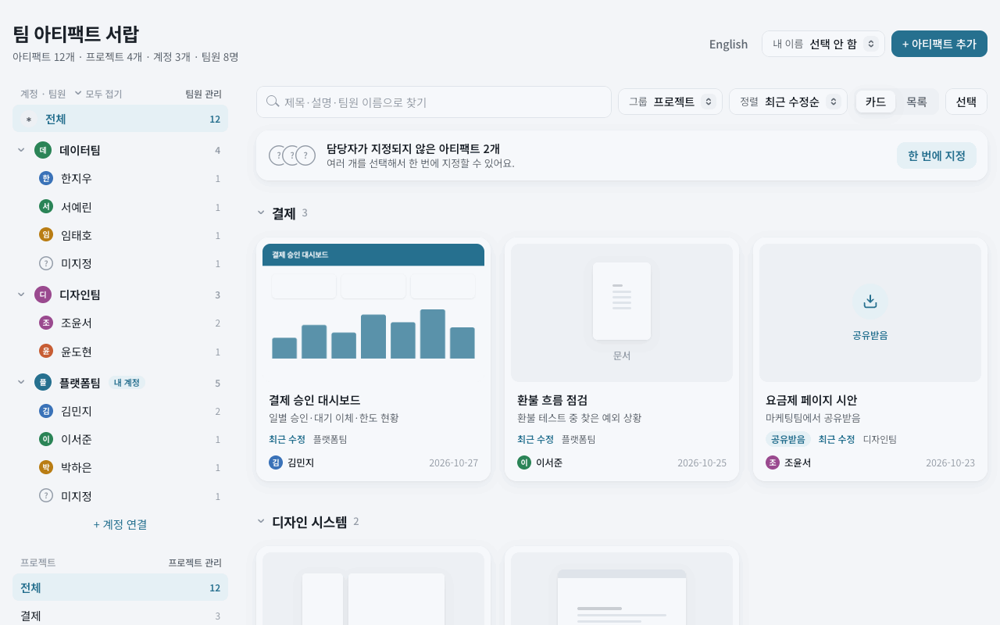
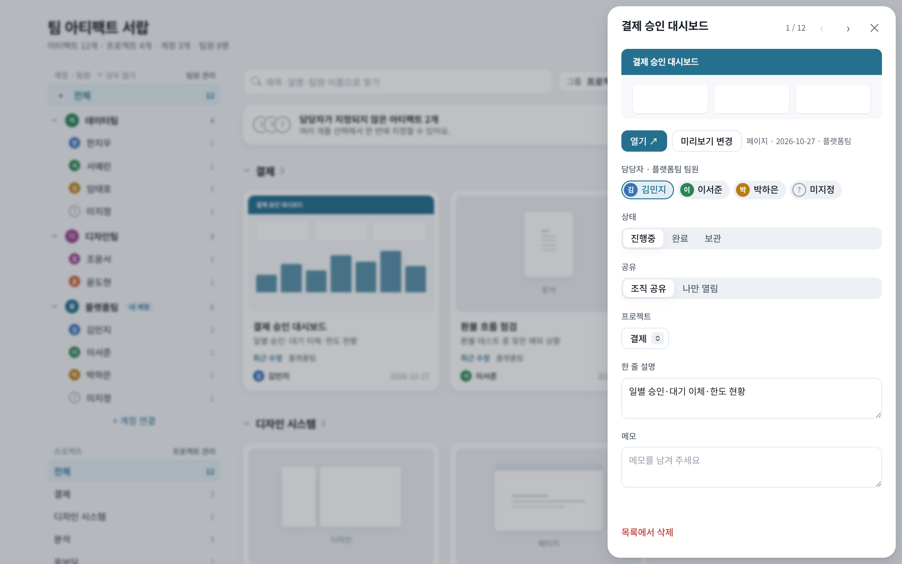
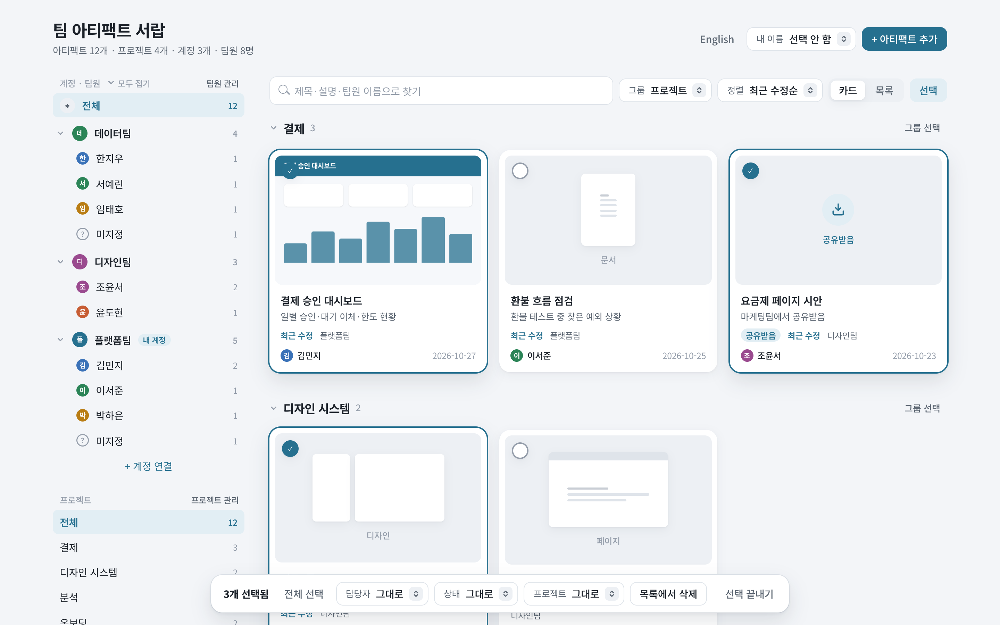

# 팀 아티팩트 서랍

[English](README.md)

여러 Claude 계정에서 팀이 만든 [Claude 아티팩트](https://claude.ai)를 한 페이지에 모아, 담당자·프로젝트·상태를 함께 관리해요.

Claude 아티팩트 갤러리는 계정마다 따로 있어서, 팀이 계정을 여러 개 쓰면 전체를 한눈에 볼 수 없어요. 이 서랍도 아티팩트 하나예요. 각 계정이 자기 아티팩트 목록을 서랍에 동기화하고, 조직 사람들은 모두 같은 페이지를 열어요.

<picture>
  <source media="(prefers-color-scheme: dark)" srcset="docs/images/ko-overview-dark.png">
  
</picture>

### 한눈에 보기



| 카드 패널 | 여러 개 고르기 |
|---|---|
|  |  |

스크린샷의 팀과 아티팩트는 모두 가상의 예시예요.

## 할 수 있는 것

- **모든 계정을 한 목록으로:** 미리보기가 있는 카드로 보여 주고, 프로젝트·담당자·계정별로 묶거나 검색해요.
- **담당자·프로젝트·상태:** 하나씩 또는 여러 개를 한꺼번에 바꿔요. 값을 고른 뒤 **확인**을 누르면 돼요. 한꺼번에 바꾼 것은 20초 안에 되돌릴 수 있어요.
- **여러 개 고르기:** 카드 위를 끌거나, Shift+클릭으로 범위를, 그룹 제목의 **그룹 선택**이나 ⌘A로 한꺼번에 골라요. Esc로 선택을 끝내요. 카드 패널에서는 ←/→로 이전·다음 카드로 넘어가요.
- **사람 찾기:** 검색창에 팀원 이름을 치면 어느 팀인지 바로 보여요. **내 이름**도 이름이나 팀으로 찾아 고를 수 있어요.
- **지우기:** **목록에서 삭제**는 숨기기라 되살릴 수 있어요. **숨긴 항목 보기**에서 **영구 삭제**하면 서랍에서 완전히 지워요(원본 아티팩트는 그대로예요).
- **손볼 것:** 자동으로 붙은 프로젝트, 만든 사람만 열 수 있는 아티팩트, 원본이 지워진 아티팩트를 모아 보여 줘요.
- **계정 연결:** 초대받은 계정이 **연결 요청**을 누르고 서랍 주인이 승인해요. 주인이 조직 디렉터리에서 찾아 미리 연결할 수도 있어요.
- **동기화 문장:** 서랍에 보이는 문장을 각 계정의 Claude Code에 붙여 넣으면 새 아티팩트와 미리보기가 들어와요. 새 것만 열어서 다시 돌려도 가벼워요.
- **한국어·영어:** 브라우저 언어를 따르고, 위쪽 버튼으로 바꿀 수 있어요.

## 필요한 것

- 런타임 기능(`db`, `assets`, `user`)을 쓰는 claude.ai 아티팩트를 발행할 수 있는 Claude Code
- 서랍을 쓰는 사람들이 서랍 주인과 같은 claude.ai 조직에 있어야 해요

## 설정 (서랍 주인이 한 번)

1. 이 저장소를 받아 그 폴더에서 Claude Code를 열어요.
2. 아래 문장을 붙여 넣어요.

   ```text
   이 폴더의 drawer.html 을 새 아티팩트로 발행해 줘.
   - capabilities: capabilities.json 내용 그대로
   - icon: folder
   발행한 뒤 그 아티팩트에 ArtifactData 로 collection "config", doc_id "meta" 를
   {"url": "<그 아티팩트의 https://claude.ai/artifact/... 링크, 물음표 뒤는 빼고>"} 로 set 해 줘.
   끝나면 링크를 알려 줘.
   ```

3. 링크를 열고, 조직에 공유하거나 팀원 계정을 **Contributor** 이상 권한으로 초대해요.
4. 서랍에서 **+ 계정 연결**을 열고 안내대로 진행해요.
   - 팀원 계정이 서랍을 열어 **연결 요청**을 누르면 주인이 승인해요.
   - 각 계정이 그 패널의 **동기화** 문장을 복사해 자기 Claude Code에서 돌려요.

2번에서 링크가 저장되지 않았다면 **계정 연결** 패널이 링크를 붙여 넣으라고 안내해요.

## 누가 무엇을 바꿀 수 있나

`capabilities.json`의 규칙은 화면에서만 숨기는 게 아니라 아티팩트 DB가 직접 막아요.

| 데이터 | 서랍 주인 | 연결된 각 계정 |
|---|---|---|
| 프로젝트 목록, 계정 이름, 연결 승인 | ✅ | ❌ |
| 서랍 주인 계정의 아티팩트·팀원 | ✅ | ❌ |
| 자기 계정의 아티팩트·팀원 | ✅ | ✅ |
| 연결 요청 | — | ✅ (자기 계정만) |

조직에서 Contributor 권한을 받은 사람은 누구나 연결을 요청하고 자기 자리에 쓸 수 있어요. 서랍에 보일지는 서랍 주인이 정해요. 프로젝트 목록은 주인만 바꾸지만, 각 아티팩트의 `project` 값은 그 계정이 정해요.

## 알아 두면 좋은 것

- **데이터는 각자의 아티팩트에 남아요.** 이 저장소에는 페이지만 있어요. 아티팩트 목록, 팀원, 미리보기는 서랍 자체의 DB와 파일 저장소에 들어가요.
- **상태 값은 한국어로 저장돼요.** 화면 언어와 상관없이 `진행중`, `완료`, `보관`으로 저장돼요. 동기화 문장은 서랍에 보이는 그대로 써 주세요.
- **미리보기**는 페이지 아티팩트만 찍어요. 문서·디자인·슬라이드는 아이콘으로 보여요.
- **아티팩트 수 제한:** 동기화는 계정마다 아티팩트를 200개까지 읽어요. 그보다 많으면 지워진 원본을 '원본 없음'으로 표시하지 못해요.
- **새 아티팩트는 기본이 '나만 보기'예요.** 각 아티팩트의 공유 메뉴에서 조직 공유를 켜야 팀원이 열 수 있어요. 서랍의 **손볼 것 → 나만 열림**에서 모아 볼 수 있어요.
- 아티팩트 런타임 `0.2.91` 기준으로 만들었어요. 플랫폼이 바뀌면 고쳐야 할 수 있어요.
