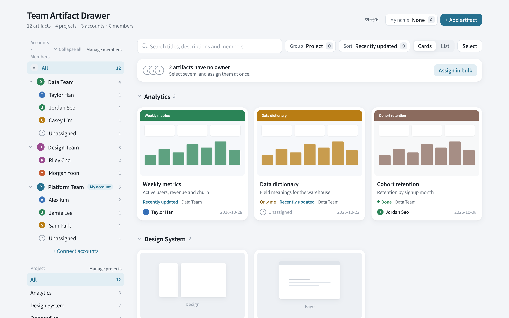
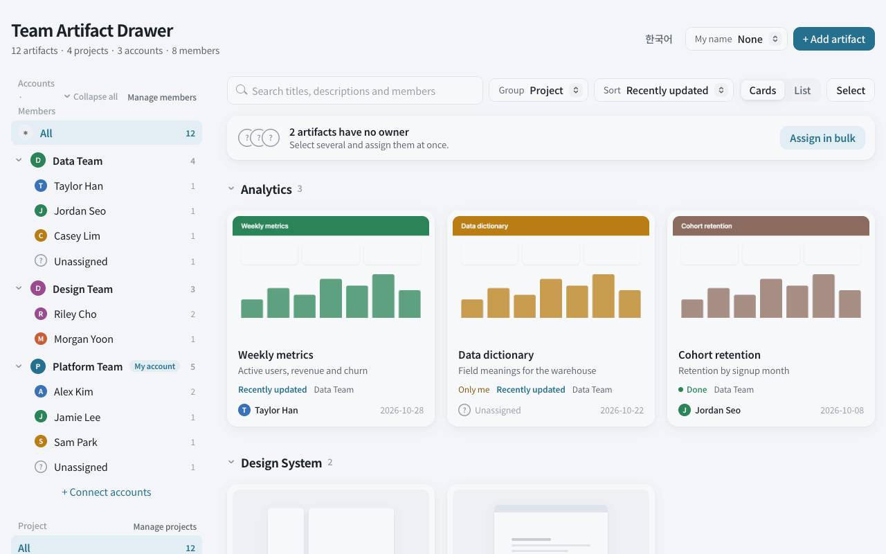
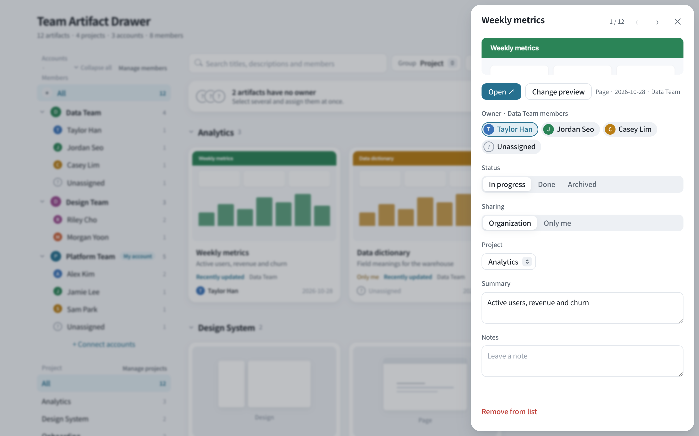
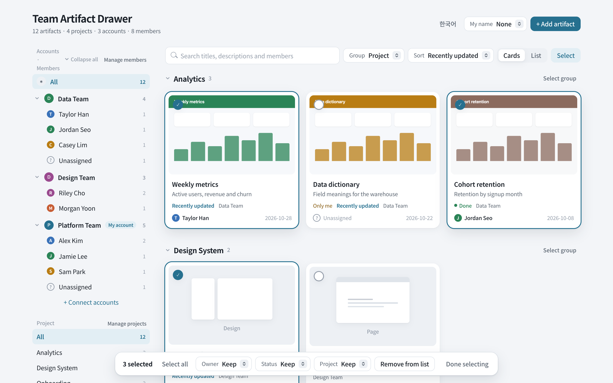

# Team Artifact Drawer

[한국어](README.ko.md)

One page that gathers the [Claude artifacts](https://claude.ai) your team makes across several Claude accounts, so you can see them together and keep track of owner, project and status.

Each Claude account only sees its own artifact gallery. If your team works from more than one account, nobody sees the whole picture. This drawer is itself an artifact: every account syncs its artifact list into it, and everyone in your organization opens the same page.

<picture>
  <source media="(prefers-color-scheme: dark)" srcset="docs/images/en-overview-dark.png">
  
</picture>

### A quick tour



| Card panel | Selecting many |
|---|---|
|  |  |

The screenshots use made-up teams and artifacts.

## What it does

- **One list for every account**: cards with previews, grouped by project, owner or account, searchable.
- **Owner, project, status**: assign them one by one or in bulk (pick values, then **Apply**). Bulk changes can be undone for 20 seconds.
- **Selecting many**: drag across cards, Shift+click for a range, **Select group** on a group header, or ⌘A. Esc ends selection. In a card's panel, ← and → move to the previous or next card.
- **Finding people**: type a member's name in the search box to see which team they're in. **My name** can also be found by name or team.
- **Removing**: **Remove from list** hides an artifact and can be restored. In **Show hidden**, **Delete permanently** removes it from the drawer for good (the original artifact is untouched).
- **Needs attention**: auto-assigned projects to confirm, artifacts only their creator can open, artifacts whose source was deleted.
- **Connecting accounts**: an invited account presses **Request connection**, and the drawer owner approves it. The owner can also pre-connect accounts from the org directory.
- **Sync prompt**: each account pastes a prompt (shown in the drawer) into Claude Code to add new artifacts and previews. It only opens artifacts that are new, so re-running it is cheap.
- **Korean and English**: follows the browser language. Switch with the button at the top.

## Requirements

- Claude Code that can publish claude.ai artifacts with runtime capabilities (`db`, `assets`, `user`).
- Everyone who uses the drawer is in the same claude.ai organization as the drawer owner.

## Setup (once, by the drawer owner)

1. Clone this repository and open Claude Code in the folder.
2. Paste this:

   ```text
   In this folder, publish drawer.html as a new Artifact.
   - capabilities: exactly the contents of capabilities.json
   - icon: folder
   After it is published, use ArtifactData on that artifact to set collection "config", doc_id "meta"
   to {"url": "<the artifact's https://claude.ai/artifact/... link, without query string>"}.
   Then give me the link.
   ```

3. Open the link. Share it with your organization (or invite teammates' accounts) with **Contributor** access or higher.
4. In the drawer, open **+ Connect accounts** and follow the steps there:
   - teammates' accounts open the drawer and press **Request connection**, and you approve them;
   - each account copies the **Sync** prompt from that panel and runs it in its own Claude Code.

If step 2 didn't save the link, the **Connect accounts** panel asks you to paste it there.

## Who can change what

The rules in `capabilities.json` are enforced by the artifact's database, not just hidden in the UI.

| Data | Drawer owner | Each connected account |
|---|---|---|
| Project list, account names, connection approvals | ✅ | ❌ |
| The owner account's artifacts and members | ✅ | ❌ |
| Its own artifacts and members | ✅ | ✅ |
| Connection request | — | ✅ (its own) |

Anyone in your organization with Contributor access can request a connection and write to their own space; the drawer owner decides who shows up. The project list is owner-only, but each account still sets the `project` value on its own artifacts.

## Good to know

- **Your data stays in your artifact.** This repository contains only the page. Artifacts, members and previews live in the drawer's own database and asset storage.
- **Status values are stored in Korean** (`진행중`, `완료`, `보관`) whatever the display language. Keep the sync prompt as shown in the drawer.
- **Previews** are captured for page artifacts only. Docs, designs and slides show an icon.
- **Artifact list limit**: sync reads up to 200 artifacts per account. Beyond that, deleted sources aren't marked as missing.
- **New artifacts are private by default.** Turn on organization sharing in each artifact's Share menu, or teammates can't open it. The drawer lists these under **Needs attention → Only me**.
- The page targets artifact runtime contract `0.2.91`. Platform changes may require updates.
